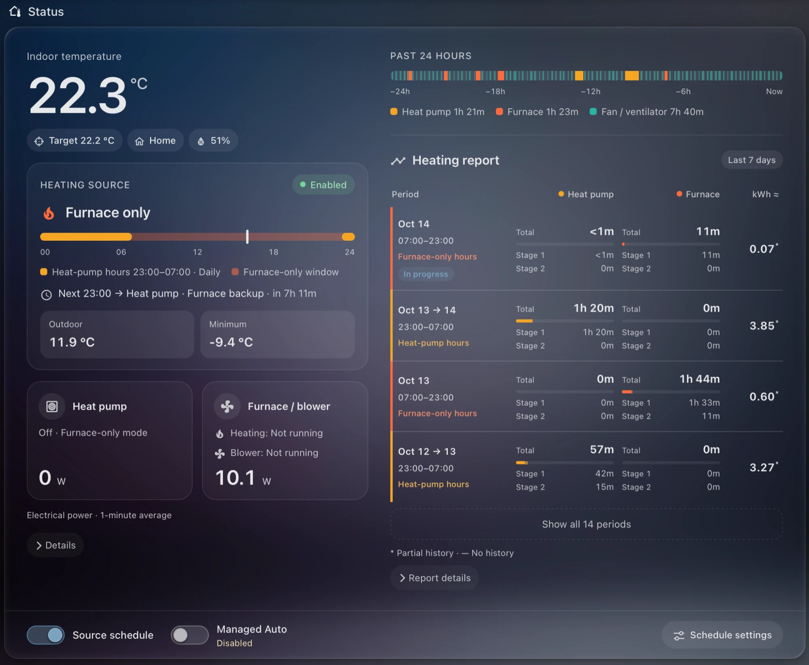
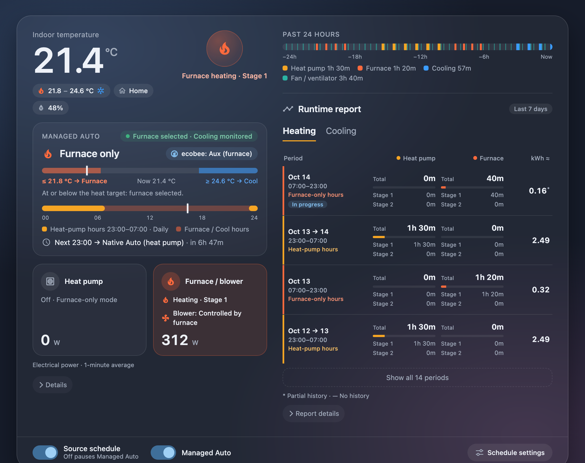

# ecobee Dual-Fuel Heat Pump Scheduler

**Schedule ecobee heating sources in Home Assistant: heat pump during cheap electricity hours, gas furnace outside them.**

[中文说明](README.zh-CN.md)

*Top: Heat mode on my system. Bottom: Managed Auto in Heat/Cool (preview with simulated data).*

## What it does

ecobee schedules temperatures, but it cannot select a heat source by time of day. This project adds source scheduling, a dashboard card and optional automatic heating/cooling control.

I chose Hydro Ottawa's ULO electricity plan because we charge our electric vehicle overnight. I also wanted the heat pump to use those cheap overnight hours. My schedule is **heat pump from 23:00–07:00, gas furnace outside that window**. You can set your own heat-pump window.

| Component | Purpose | When to install |
| --- | --- | --- |
| **Blueprint** | Sets the heat-pump window and selects furnace heating outside it | Required |
| **Dashboard card** | Shows source, stages, power and history, with controls and settings links | For dashboard access |
| **Managed Auto integration** | Applies the same heating-source schedule in Heat/Cool while allowing heat-pump cooling | For automatic heating/cooling |

Keep setting temperatures, Comfort Settings and participating room sensors in **ecobee's schedule**. During the heat-pump window, ecobee can still call the furnace under its native auxiliary-heating rules.

**Requirements:** a heat pump + gas furnace dual-fuel system, and HA's **native ecobee integration** exposing the thermostat and its **Auxiliary heat only** switch. HomeKit alone is not sufficient. The Blueprint supports HA 2024.12+; the card and Managed Auto are currently validated on HA 2026.10.1.

## Install and configure

Use **HACS** to install the Blueprint, card and optional Managed Auto together. **Public test version: HACS installation and migration verified on HA 2026.10.1.** [Acceptance results](docs/hacs-acceptance.md)

### 1. Install through HACS

1. Open **HACS → ⋮ → Custom repositories**. Add `https://github.com/maigougou/ha-ecobee-dual-fuel-heat-pump-scheduler` as **Integration**.
2. Find **ecobee Dual-Fuel Heat Pump Scheduler**, download it and restart HA.
3. Open **Settings → Devices & services → Add integration → ecobee Dual-Fuel Heat Pump Scheduler**. Choose **Install Blueprint and card**, select the Blueprint language and submit.

The Blueprint is installed and the card registered automatically. Refresh your browser; no file copying or JavaScript resource setup is needed. [Without HACS: installation script](docs/installation.md)

### 2. Set the heating-source schedule

1. Open **Settings → Automations & scenes → Blueprints** and create an automation from this Blueprint.
2. Select the ecobee thermostat and its **Auxiliary heat only** switch, then set the heat-pump window and weekdays. The default is **23:00–07:00 daily**; weekdays refer to the day the window starts.
3. Save and select **⋮ → Run actions**. Check the observation result in Notifications. When correct, turn **Observation mode** off, leave the automation enabled and select **Heat** on ecobee.

Keep setting target temperatures in ecobee. Compressor minimum outdoor temperature management is optional in the same Blueprint form.

### 3. Add the card

Edit a dashboard, add **ecobee Dual-Fuel Heat Pump**, and select the thermostat, Auxiliary heat only switch and schedule automation.

If you have power monitoring, select the heat-pump and furnace **W/kW power sensors**. Vue and other brands work. Without sensors, the corresponding power and electricity readings are hidden; the runtime report still works and can also be hidden in the editor. [Card settings](docs/dashboard.md)

### 4. Automatic heating/cooling (optional)

Add the **ecobee Dual-Fuel Heat Pump Scheduler** integration again and choose **Add Managed Auto controller**. Select the thermostat, Auxiliary heat only switch and schedule automation. Then:

1. Select the new Managed Auto switch in the Blueprint's **Managed Auto controller (optional)** field and in the card editor.
2. Keep the schedule enabled and observation mode off, turn on **Managed Auto**, and set ecobee to **Heat/Cool**.

| Period | Heating needed | Cooling needed |
| --- | --- | --- |
| Inside the heat-pump window | Heat pump, with native auxiliary backup | Heat pump |
| Outside the window | Gas furnace | Heat pump |

Outside the window, HA switches between **Auxiliary heat only** and **Cool**. **An outage leaves the thermostat in its last mode without automatic heat/cool changeover.** [Managed Auto settings](docs/managed-auto.md)

## Use

| What you want to change | Where to do it |
| --- | --- |
| Heat-pump hours | **Schedule settings** on the card, or edit the Blueprint automation |
| Temperatures, morning warm-up or participating rooms | ecobee Comfort Settings and Schedule |
| Power sensors, report visibility or language | Card editor |
| Automatic heat/cool switching interval | **Settings → Devices & services → ecobee Dual-Fuel Heat Pump Scheduler → controller entry → Configure** |
| Heating only | Select **Heat** on ecobee; the Blueprint schedules the source |
| Automatic heating/cooling | Enable Managed Auto and select **Heat/Cool** on ecobee |
| Summer cooling only | Select **Cool** on ecobee; the heat pump cools |
| Pause source scheduling | Disable the schedule automation; ordinary Heat retains its last source, while Managed Auto attempts to restore native Auto |

Scheduling uses ecobee's cloud and may take several minutes at a window boundary. Check an actual source transition after first enabling it.

**Updates:** download the update in HACS, restart HA and refresh the browser. Existing automation and card settings are retained. If an existing Blueprint was replaced, reload automations too. Before removing a Managed Auto controller, turn its switch off and confirm native Auto is restored. [Maintenance and removal](docs/installation.md#updates-and-removal)

---

[Design and limits](docs/design.md) · [Development and tests](CONTRIBUTING.md) · [Changelog](CHANGELOG.md) · [MIT license](LICENSE)
