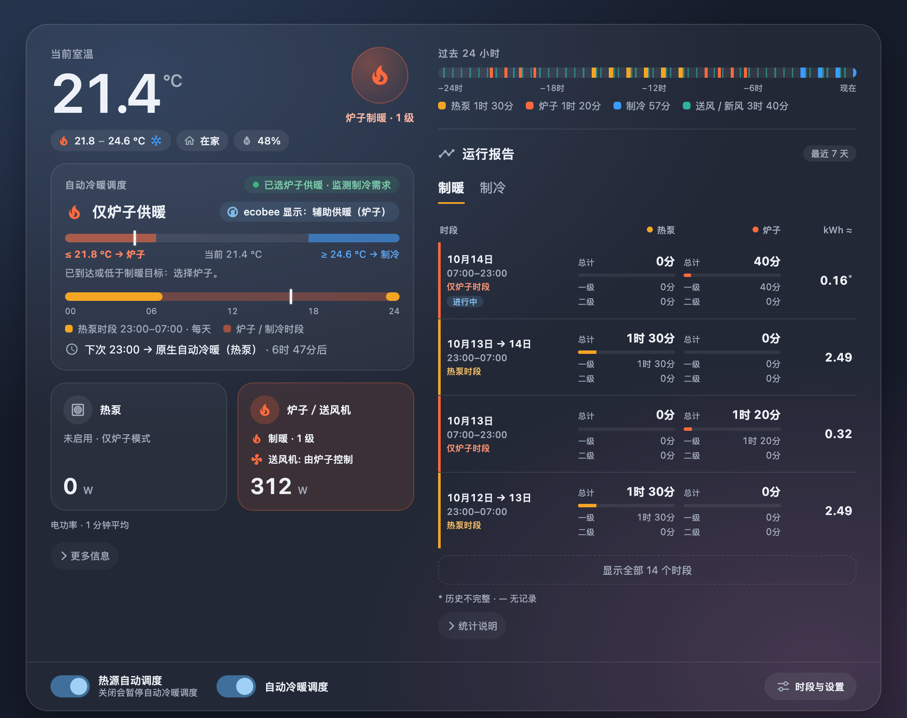

# ecobee Dual-Fuel Heat Pump Scheduler

**在 Home Assistant 中按时段选择 ecobee 的供暖热源：低电价时用热泵，其他时段用燃气炉。**

[English](README.md)

*上图：我家系统的 Heat 模式实拍。下图：Heat/Cool 下的 Managed Auto（预览页，模拟数据）。*

## 这是做什么的

ecobee 的日程可以设置温度，但不能按电价时段选择热源。这个项目补上热源调度，并提供状态卡片和可选的自动冷暖控制。

我家有电动车需要夜间充电，所以选择了 Hydro Ottawa 的 ULO 电价计划，也希望热泵更多利用夜间低价电供暖。我的设置是 **23:00–07:00 用热泵，其他时段用燃气炉**。你可以设置自己的热泵运行时段。

| 组件 | 用途 | 什么时候安装 |
| --- | --- | --- |
| **Blueprint** | 设置热泵时段，窗口外切换为炉子供暖 | 必装 |
| **仪表盘卡片** | 显示热源、运行级数、功率和历史报告，提供设置入口 | 想在仪表盘查看和操作时 |
| **Managed Auto 集成** | 在 Heat/Cool 下按相同时段选择供暖热源，同时允许热泵制冷 | 使用自动冷暖时 |

目标温度、Comfort Settings 和房间传感器继续在 **ecobee 日程**中设置。热泵时段仍允许 ecobee 按本机条件调用炉子辅助供暖。

**使用条件：** 热泵＋燃气炉双燃料系统；HA 已连接**原生 ecobee 集成**，并有同一设备的温控器实体和 **Auxiliary heat only** 开关。只有 HomeKit 连接不够。Blueprint 支持 HA 2024.12+，卡片和 Managed Auto 当前在 HA 2026.10.1 上验证。

## 安装和配置

首选 **HACS**，一次安装包含 Blueprint、卡片和可选的 Managed Auto。**当前为公开测试版本，已在 HA 2026.10.1 完成 HACS 安装与迁移验收。** [验收记录](docs/hacs-acceptance.zh-CN.md)

### 1. 在 HACS 安装

1. 打开 **HACS → ⋮ → 自定义仓库**，输入 `https://github.com/maigougou/ha-ecobee-dual-fuel-heat-pump-scheduler`，类型选择 **Integration**。
2. 找到 **ecobee Dual-Fuel Heat Pump Scheduler**，下载并重启 HA。
3. 打开 **设置 → 设备与服务 → 添加集成 → ecobee Dual-Fuel Heat Pump Scheduler**，选择 **安装蓝图和卡片**，选择蓝图语言并提交。

蓝图会自动安装，卡片会自动注册。刷新浏览器即可使用，无需复制文件或添加 JavaScript 资源。[不用 HACS？使用安装脚本](docs/installation.md)

### 2. 设置热源时段

1. 打开 **设置 → 自动化与场景 → 蓝图**，用本蓝图创建自动化。
2. 选择 ecobee 温控器和同一设备的 **Auxiliary heat only** 开关，填写热泵时段和星期。默认每天 **23:00–07:00**；星期指窗口开始的那一天。
3. 保存后点击 **⋮ → 运行动作**，在通知中查看观察结果。确认正确后关闭**观察模式**，保持自动化开启，将 ecobee 设为 **Heat**。

目标温度继续在 ecobee 设置。压缩机最低室外温度管理是同一表单中的可选项。

### 3. 添加卡片

编辑仪表盘，添加 **ecobee Dual-Fuel Heat Pump**，选择温控器、Auxiliary heat only 开关和调度自动化。

有能耗监控时，再选择热泵和炉子的 **W/kW 功率传感器**；Vue 和其他品牌均可。不配置则不显示对应功率和电量，运行报告仍可用，也可以在编辑器中关闭。[卡片设置](docs/dashboard.zh-CN.md)

### 4. 自动冷暖（可选）

再次添加 **ecobee Dual-Fuel Heat Pump Scheduler** 集成，选择 **添加自动冷暖控制器**，选好温控器、Auxiliary heat only 开关和调度自动化。然后：

1. 在 Blueprint 的 **自动冷暖控制器（可选）** 和卡片编辑器中，选择新增的 Managed Auto 开关。
2. 保持调度自动化开启、观察模式关闭，打开 **Managed Auto**，将 ecobee 设为 **Heat/Cool**。

| 时段 | 需要供暖 | 需要制冷 |
| --- | --- | --- |
| 热泵窗口内 | 热泵，保留本机辅助供暖 | 热泵 |
| 窗口外 | 燃气炉 | 热泵 |

窗口外由 HA 在 **Auxiliary heat only** 和 **Cool** 之间切换。**断线时设备保持最后模式，不能继续自动切换冷暖。** [Managed Auto 设置](docs/managed-auto.md)

## 日常使用

| 想做什么 | 在哪里操作 |
| --- | --- |
| 修改热泵时段 | 卡片的 **Schedule settings**，或编辑 Blueprint 自动化 |
| 修改室温、晨间预热、参与控温的房间 | ecobee 的 Comfort Settings 和 Schedule |
| 选择功率传感器、是否显示报告、语言 | 卡片编辑器 |
| 调整自动冷暖切换间隔 | **设置 → 设备与服务 → ecobee Dual-Fuel Heat Pump Scheduler → 控制器条目 → 配置** |
| 只制暖 | ecobee 选择 **Heat**，由 Blueprint 调度热源 |
| 自动冷暖 | 启用 Managed Auto，ecobee 选择 **Heat/Cool** |
| 夏季只制冷 | ecobee 选择 **Cool**，由热泵制冷 |
| 暂停热源调度 | 关闭调度自动化；普通 Heat 保留最后热源，Managed Auto 会尝试恢复原生 Auto |

调度通过 ecobee 云端执行，不能保证边界时刻立即切换。首次启用后，检查一次实际时段切换。

**更新：** 在 HACS 下载更新，重启 HA 并刷新浏览器。已有自动化和卡片设置会保留。若升级替换了已有蓝图，再重新加载自动化。卸载 Managed Auto 控制器前先关闭其开关，确认恢复原生 Auto。[维护与卸载](docs/installation.md#updates-and-removal)

---

[设计与限制](docs/design.md) · [开发与测试](CONTRIBUTING.md) · [更新记录](CHANGELOG.md) · [MIT 许可证](LICENSE)
